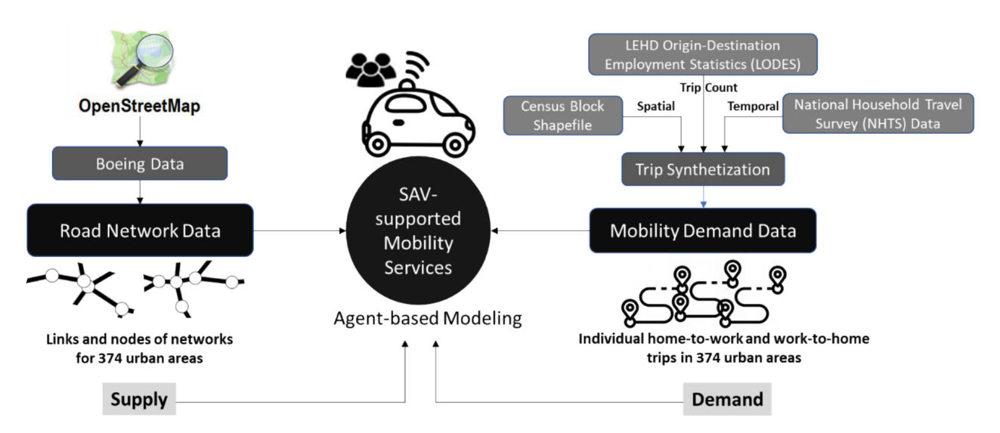
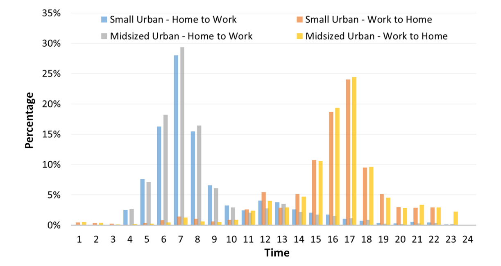
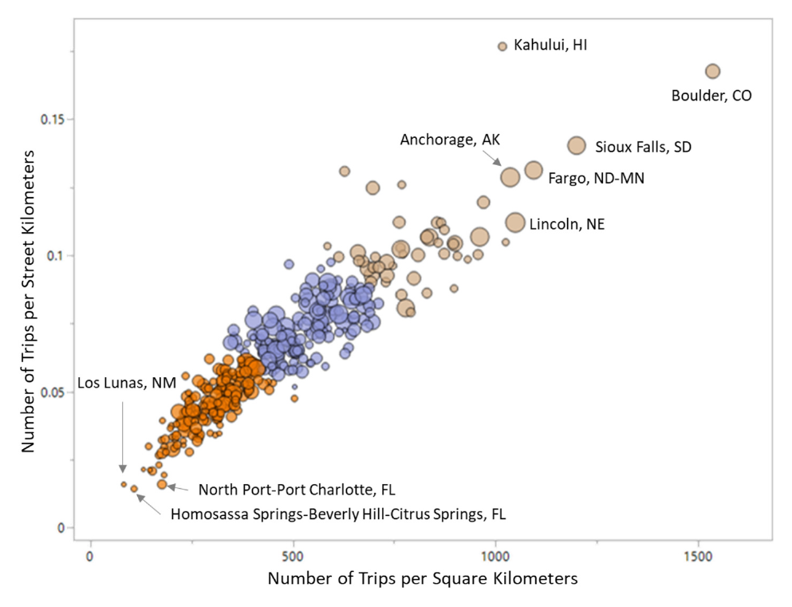

# Alabama Synthetic Work Trips

Synthetic home-to-work and work-to-home commuting trips for 12 Alabama urbanized areas, extracted from the 374-area dataset of Zhang et al. (2025). Trip files are in `data/`, one CSV per urbanized area.

**Source paper:** Zhang, Z., et al. (2025). *Envisioning shared autonomous vehicles (SAVs) for 374 small and medium-sized urban areas in the United States: The roles of road network and travel demand.* Journal of Transport Geography, 127, 104302. https://doi.org/10.1016/j.jtrangeo.2025.104302

This note pulls together only the **synthetic trip** part of the paper (Section 4.1–4.3, Section 5.2, Table 1, Fig. 2, Fig. 3, Fig. 9, and the data remarks in the conclusions), cross-checked against the two R scripts that generated the data (`synthetic_work_trips.R` and `Combine census block and OD data.R`, not included here). Section 7 documents the Alabama subset stored in this folder.

---

## 1. Purpose and scope

The paper simulates SAV fleets serving commuting trips in 374 small and medium-sized U.S. urbanized areas. No consistent local travel-demand data exist for that many areas, so the authors built a single, uniform method to synthesize individual **home-based work (HBW)** trips for every area from public Census data, and then used the same trip data as demand input for an agent-based SAV model.

Key scope decisions:

- Only **home-to-work (HW)** and **work-to-home (WH)** trips. Non-home-based and discretionary trips are not included (listed as future work).
- Only **internal–internal** trips: both ends inside the same urbanized area (plus a small tolerance, see Section 3.3). Internal–external and external–internal commuting is excluded.
- Every worker makes exactly **one HW trip and one WH trip** that form a closed tour (the origin block of one trip is the destination block of the other).
- Trip ends are **census block centroids**, not addresses.
- The output is **demand only**: no mode, no route, no travel time. Travel times in the paper come later from the SAV simulation on the OpenStreetMap network.
- Result: nearly **30 million** synthetic trips across the 374 areas.

The paper frames the dataset itself as a deliverable: "an important product of this study is the large-scale synthetic commuting trip data for 374 small and medium-sized urban areas."

---

## 2. Data sources

| Role | Source | Details |
|---|---|---|
| OD trip counts | LEHD Origin-Destination Employment Statistics (**LODES**), U.S. Census Bureau | 2019 block-to-block home→work flows (`h_geocode`, `w_geocode`, total jobs `S000`). |
| Spatial coordinates | Census TIGER **block shapefiles** (2010 vintage attributes `GEOID10`, `UACE10`, `INTPTLAT10`, `INTPTLON10`) | Block internal-point lat/lon used as trip origin/destination; `UACE10` tells which urbanized area a block belongs to. |
| Departure-time distributions | **NHTS 2017** trip file (FHWA, 2018) | HBW trips only, split into four groups (trip direction × urban size). |
| Study-area list and attributes | `urban data for modeling corrected.csv` (487 urbanized areas) | Population, area, density, road-network graph measures (from Boeing 2020), PCA scores, and cluster labels. Filtered to the 374 study areas. |
| Road network (supply side, not part of the trip data) | Boeing (2020) OpenStreetMap network extracts | Used only by the SAV simulation. |

Figure 2 from the paper shows how these pieces fit together. The right-hand branch is the trip synthesis.



*Fig. 2 (Zhang et al., 2025). Overview of data preparation and system operation modeling.*

---

## 3. Trip synthesis methodology

### 3.1 Study-area selection

- Urbanized areas were taken from the 487-row urban data table and filtered to **total population < 350,000** (`Totalpop_age < 349999` in the script), yielding 374 areas.
- Two size classes drive which departure distribution is used:
  - **Small urban area:** population 50,000 – 199,999
  - **Midsized urban area:** population 200,000 – ~375,000

### 3.2 Build block-level OD table (`Combine census block and OD data.R`)

1. Stack all state block shapefile attribute tables into one national block table (`whole_country_census_block.csv`, 1.3 GB).
2. For each state's LODES OD file, join home block and work block to the block table to attach urbanized-area code and lat/lon to both ends.
3. Keep only OD pairs where **either** end lies in one of the 374 study areas, and stack into `whole_country_small_urban_OD.csv` (3.6 GB).

### 3.3 Expand OD counts into individual travelers (`synthetic_work_trips.R`)

1. Each OD row is repeated `S000` times (one row per job), so each row becomes one traveler with a `personid`, a home block, and a work block.
2. For each study area, keep travelers where home or work is in the area, **and** either (a) both home and work are in the area, or (b) home and work are within **0.15° latitude and 0.15° longitude** of each other (roughly 15 km). Rule (b) admits short commutes that cross the urbanized-area boundary while excluding long-distance ones.

### 3.4 Departure-time distributions (NHTS)

- HBW trips were pulled from the NHTS trip file and grouped into four types:
  - type 1: small urban, home→work
  - type 2: small urban, work→home
  - type 3: midsized urban, home→work
  - type 4: midsized urban, work→home
- Each group was binned into **48 half-hour bins** (0:00–23:30), weighted by trip weight, and normalized to shares. The result is stored in `trip_departure_distribution.csv`.
- Small-sample smoothing applied in the script: for types 1 and 2 the late-night bins (0:00–1:00 and 23:00–24:00) were averaged; for types 1 and 3 the bins from 1:00 to 4:00 were averaged.



*Fig. 3 (Zhang et al., 2025). Time distributions of trip departures, by hour, for the four groups. HW peaks at 7:00 (≈28–29%), WH peaks at 17:00 (≈24%). Small and midsized profiles are nearly identical.*

### 3.5 Assigning home→work departure times

For each urban area with *N* travelers:

1. For each half-hour bin *i*, draw `round(N × share_i)` departure times uniformly within that half hour (so times are continuous, not on the half hour).
2. Shuffle; if rounding left fewer than *N* times, pad with uniform random times over 24 h; if more, truncate to *N*.
3. Assign one time per traveler as the HW departure.

A second pool of *N* WH departure times is drawn the same way from the WH distribution.

### 3.6 Pairing work→home times with travelers (work-duration constraint)

The paper states the gap between a traveler's HW and WH trip "should be around 7 to 8 h, except for a small portion of people who may have a part-time job." The script implements this as a greedy hour-by-hour matching:

1. Walk through the day in 1-hour windows. In each window, take the unassigned WH times that fall in it and the travelers who left home **between 7 and 8 h earlier** (wrapping past midnight if needed). Randomly match as many pairs as the smaller set allows.
2. After a full day pass at 8 h, repeat the pass with target gaps of 9, 10, 11 and 12 h, then 7, 6, 5, 4 and 3 h, each time only using travelers and times not yet matched.
3. Any traveler still without a WH time receives one of the leftover WH times.

The outcome preserves the NHTS WH time-of-day distribution exactly while making most work durations 7–12 h, with a short tail of shorter days.

### 3.7 Output

For each area, two records per traveler are written (HW = `triptype 1`, WH = `triptype 2`) with coordinates, block codes, departure minutes, and a formatted clock time (see Section 6). One CSV per urbanized area, named by the area's Census urban-area code (`geoid`).

---

## 4. Results reported in the paper that concern the synthetic trips

### 4.1 Volume

- Nearly **30 million** HW + WH trips across 374 areas (Section 4.3, Section 5.2, Conclusions).

### 4.2 Trip density (Section 5.2, Fig. 9)

Two density measures were computed per area:

- Trip Density (area) = Number of Trips / Area Size (trips per km²)
- Trip Density (road) = Number of Trips / Total Road Length (trips per street km)

The two are highly correlated. Clustering on them split the 374 areas into three groups:

- **Cluster 1, low density:** e.g., Homosassa Springs–Beverly Hills–Citrus Springs FL, Los Lunas NM, North Port–Port Charlotte FL.
- **Cluster 2, medium density.**
- **Cluster 3, high density:** e.g., Kahului HI, Boulder CO, Sioux Falls SD, Fargo ND–MN, Anchorage AK, Lincoln NE.



*Fig. 9 (Zhang et al., 2025). Clusters of trip density (over area and street km) in 374 urban areas. Bubble size = number of commuters.*

### 4.3 Trip-duration distribution (Section 5.2, Table 1)

Trip duration was obtained from the simulation (SAV travel time on the OSM network at posted speeds), so it is a derived attribute of the synthetic trips rather than part of the trip files. Shares of trips in four bins (0–5, 5–10, 10–20, >20 min) were computed per area. Table 1 lists the top 10 areas per bin:

| # | 0–5 min | 5–10 min | 10–20 min | Over 20 min |
|---|---|---|---|---|
| 1 | Lompoc CA 64.5% | Lake Havasu City AZ 47.0% | Lafayette–Louisville–Erie CO 64.7% | Fort Walton Beach–Navarre–Wright FL 32.9% |
| 2 | Grand Forks ND–MN 55.6% | Cheyenne WY 44.6% | Camarillo CA 62.8% | Myrtle Beach–Socastee SC–NC 28.9% |
| 3 | Grand Island NE 55.4% | Bloomington–Normal IL 42.3% | Twin Rivers–Hightstown NJ 58.5% | Kailua–Kaneohe HI 28.4% |
| 4 | Walla Walla WA–OR 54.1% | Columbia MO 41.7% | Mauldin–Simpsonville SC 55.2% | Arroyo Grande–Grover Beach CA 27.7% |
| 5 | Delano CA 53.8% | St. Joseph MO–KS 41.2% | Thousand Oaks CA 52.5% | Barnstable Town MA 27.1% |
| 6 | Great Falls MT 53.6% | Lawrence KS 41.1% | Fairfield CA 52.2% | Longmont CO 26.4% |
| 7 | Manhattan KS 52.6% | Salem OR 40.6% | Simi Valley CA 51.6% | Port Arthur TX 26.3% |
| 8 | Madera CA 51.5% | Lewiston ID–WA 40.3% | Kailua–Kaneohe HI 50.9% | Asheville NC 24.5% |
| 9 | Pocatello ID 49.0% | Anchorage AK 40.1% | Clarksville TN–KY 50.4% | Beaumont TX 24.0% |
| 10 | Kahului HI 48.8% | Sioux Falls SD 39.8% | Brunswick GA 50.3% | Texas City TX 23.8% |

### 4.4 How trip characteristics entered the later models

Trip density and the trip-duration shares (e.g., percent of trips under 10 min) were used as the travel-demand explanatory variables (X_trip) in the six regression models of SAV fleet performance (Section 4.5). Denser or longer trips were associated with lower fleet efficiency (trips per vehicle) but lower empty-VMT share.

---

## 5. Limitations noted in the paper

- HBW trips only; no non-home-based or discretionary trips. The authors plan to extend the data to full daily activity chains.
- Internal–internal commutes only.
- Trip ends snap to block centroids.
- No mode choice: the SAV analysis assumes every commute is served by an SAV, so demand would need local calibration for adoption.
- Departure distributions are national NHTS profiles by urban size, not area-specific.
- LODES counts are jobs (employer-reported), so a person with two jobs appears twice.

---

## 6. File format (one CSV per urbanized area)

| Column | Type | Meaning |
|---|---|---|
| `personid` | int | Traveler ID; unique within a file. Each ID appears twice (one HW row, one WH row). |
| `triptype` | int | 1 = home→work, 2 = work→home |
| `start_x`, `start_y` | float | Origin longitude, latitude (block internal point) |
| `end_x`, `end_y` | float | Destination longitude, latitude |
| `start_geocode` | int | Origin census block GEOID (15 digits) |
| `end_geocode` | int | Destination census block GEOID |
| `depart_min` | float | Departure time in minutes after midnight (continuous) |
| `depart_time` | string | Same time as `H:M:S` (not zero-padded, e.g. `6:52:55`) |

For `triptype 1`, `start_geocode` is the LODES home block and `end_geocode` is the work block; for `triptype 2` they are swapped. The file name is the Census urbanized-area code (`geoid` in `urban data for modeling corrected.csv`).

---

## 7. Alabama subset in this repository

The 12 study areas in or partly in Alabama are in `data/`. `city_index.csv` holds the same table in machine-readable form.

| geoid | Urbanized area | Size class | Pop. (2010) | Area km² | Trips (rows) | Travelers | Median HW dep. | Median WH dep. | Mean straight-line km | Home blocks | Work blocks |
|---|---|---|---|---|---|---|---|---|---|---|---|
| 57925 | Mobile AL | Midsized | 327,445 | 576.7 | 203,360 | 101,680 | 7:45 | 16:59 | 10.1 | 6,206 | 2,967 |
| 40780 | Huntsville AL | Midsized | 303,991 | 543.2 | 214,832 | 107,416 | 7:45 | 16:59 | 10.7 | 5,823 | 2,470 |
| 19099 | Columbus GA–AL | Midsized | 256,550 | 381.3 | 126,568 | 63,284 | 7:45 | 16:59 | 8.1 | 3,877 | 1,489 |
| 58600 | Montgomery AL | Midsized | 254,707 | 397.6 | 158,428 | 79,214 | 7:45 | 16:59 | 10.1 | 4,314 | 1,580 |
| 89110 | Tuscaloosa AL | Small | 150,061 | 231.7 | 90,396 | 45,198 | 7:51 | 16:53 | 7.5 | 2,850 | 1,113 |
| 4033 | Auburn AL | Small | 80,620 | 129.3 | 49,904 | 24,952 | 7:51 | 16:53 | 7.0 | 1,600 | 563 |
| 29953 | Florence AL | Small | 78,979 | 161.0 | 50,698 | 25,349 | 7:51 | 16:52 | 7.7 | 3,113 | 912 |
| 2629 | Anniston–Oxford AL | Small | 76,222 | 224.8 | 38,126 | 19,063 | 7:51 | 16:53 | 9.0 | 2,708 | 732 |
| 24472 | Dothan AL | Small | 69,884 | 143.9 | 50,504 | 25,252 | 7:51 | 16:52 | 7.6 | 2,631 | 748 |
| 22690 | Decatur AL | Small | 68,442 | 151.1 | 39,386 | 19,693 | 7:51 | 16:53 | 8.2 | 2,540 | 691 |
| 22285 | Daphne–Fairhope AL | Small | 65,806 | 143.1 | 28,890 | 14,445 | 7:51 | 16:53 | 8.9 | 1,558 | 793 |
| 32113 | Gadsden AL | Small | 63,540 | 186.5 | 33,998 | 16,999 | 7:51 | 16:53 | 7.8 | 2,503 | 643 |

Notes:

- **Birmingham AL** (pop. 756,636) and **Pensacola FL–AL** (pop. 360,703) are in the urban data table but exceed the 350,000 population cutoff, so no trip file exists for them.
- **Columbus GA–AL** straddles the Georgia–Alabama line; most of it is in Georgia. Drop it if a strictly Alabama sample is needed.
- The four midsized areas were generated with the midsized NHTS distributions (types 3/4) and the eight small areas with the small-urban distributions (types 1/2); the median departure times above reflect that split.
- "Mean straight-line km" is the great-circle distance between the two block centroids, computed here for reference; the paper's trip durations are network travel times from the simulation and are not in these files.
- `Cluster` in `city_index.csv` is the road-network cluster label from the urban data table, not the trip-density cluster of Fig. 9.

Repository layout:

```
Alabama-Synthetic-Work-Trips/
├── README.md                this document
├── city_index.csv           geoid, name, population, area, density, cluster, row count
├── data/
│   └── 2629.csv … 89110.csv 12 trip files (one per urbanized area)
└── figures/
    ├── Fig2_data_preparation_overview.png
    ├── Fig3_trip_departure_distributions.png
    └── Fig9_trip_density_clusters.png
```

## Citation

If you use these data, please cite:

Zhang, Z., et al. (2025). Envisioning shared autonomous vehicles (SAVs) for 374 small and medium-sized urban areas in the United States: The roles of road network and travel demand. *Journal of Transport Geography*, 127, 104302. https://doi.org/10.1016/j.jtrangeo.2025.104302
